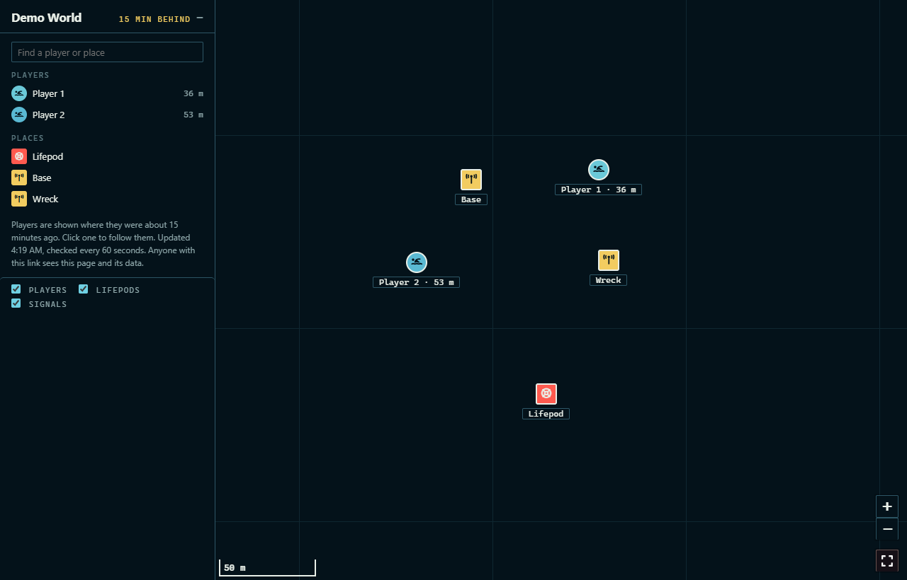
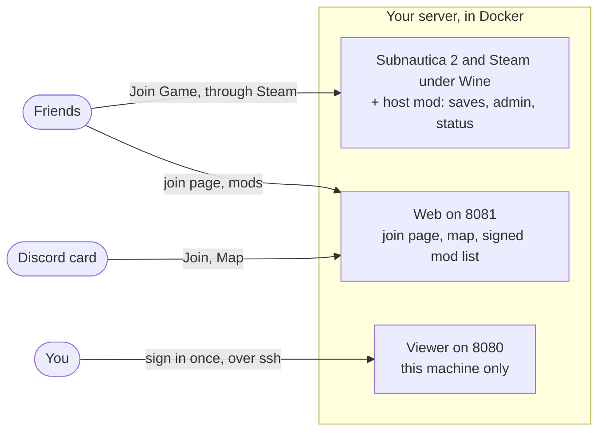
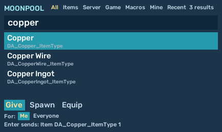

# Moonpool

Keeps your Subnautica 2 world online so friends can play when you can't.

Moonpool runs the real game under Wine in Docker, on a spare PC or a server, signed in to a Steam account of its own. No GPU needed.

- Unofficial: not affiliated with Unknown Worlds, KRAFTON or Valve.
- No game files in this repo, and nothing here is for sale.
- Running it likely breaks the game's and Steam's terms: read [Risk](#risk) before you start.




## How it works



## For your friends

They add the hosting account as a Steam friend and press Join Game, or open the join page. Nothing to install unless the server uses mods.

## What you need

- An x86-64 (amd64) machine. The image's Wine and other pieces are built for amd64 only; ARM machines such as a Raspberry Pi or an Apple Silicon Mac can't run it.
- Docker Engine 26 and Compose 2.25 or newer, on Linux or Docker Desktop. On Windows, run the shell commands below in Docker Desktop's WSL shell.
- Python 3.8 or newer on that machine, for `bin/moonpool`.
- For 4 players: about 4 cores, 8 GB of memory and 40 GB of SSD. Four is the game's own limit; `PLAYER_SLOTS` allows more, but that's rarely tested.
- A Steam account that owns the game and is used only for hosting. Signing it in anywhere else logs the host out.
- Friends need their own copy on Steam. Xbox and Game Pass joining is experimental ([guide](docs/operating.md#xbox-and-game-pass-players)).

## Start it

```sh
git clone https://github.com/moonpool-server/moonpool.git
cd moonpool
git checkout "$(git describe --tags --abbrev=0)"
cp .env.example .env
docker compose up -d --build
```

1. Open `http://127.0.0.1:8080/vnc.html` and sign in to Steam once. `bin/moonpool diag viewer` shows the password. From another machine: `ssh -L 8080:127.0.0.1:8080 you@server`.
2. Wait for the game to download and the world to load (`docker compose logs -f sn2`). Accept any licence prompt yourself in the viewer.
3. `bin/moonpool status` says when it's hosting. Never run `docker compose down -v`: it deletes the world and the Steam sign-in.
4. Invite each friend: `bin/moonpool players invite <steamid64 or profile link>`. They send the hosting account a friend request; accept it in the viewer, or set `AUTO_ACCEPT_FRIENDS=1`.
5. Friends press Join Game, or open `http://<server>:8081/join`.

Anyone already friends with the hosting account can join too. `ALLOWLIST_ONLY=false` lets in anyone who finds it.

## Gameplay defaults

The default `PRESET=friends` changes the game for a group that drops in and out. `PRESET=stock` turns all of it off; each can also be set on its own in [.env.example](.env.example).

| Change | What players notice | Setting |
|---|---|---|
| Shared unlocks | each joining player gets the base pieces, tools and scanned blueprints the host has unlocked | `UNLOCK_REPLAY` |
| Story start | the first lifepod goals complete once a real player arrives, so lifepods launch on a fresh world | `STORY_GOALS` |
| Voice range warning | a private amber signal marks another player who is too far away to hear | `VOICE_WARN`, `VOICE_RANGE_M` |
| Hotbar slots | with a slot mod such as Ultimate Player Tweaks, the hotbar gets the mod's 10 slots; this game build otherwise caps it at 8 | `TOOLBAR_SLOTS` |
| Launch hold | new joins wait while the lifepod launch cinematic plays (not yet proven) | `LIFEPOD_JOIN_HOLD` |
| Empty server | the clock stops after 10 minutes with nobody in, and the frame rate drops | `IDLE_FREEZE_MINUTES`, `IDLE_MAX_FPS` |
| Faster joins | each joiner gets world data at 3× the game's rate | `NET_MAX_CLIENT_RATE` |

Always on: the hosting account has no visible body and isn't counted as crew.

## Bring your world

```sh
bin/moonpool server import SaveGames.zip   # a world from the PC that hosted it
bin/moonpool server export                 # a zip of the hosted world
```

- If the game can't load an imported world, the old one is put back.
- Where saves are and which builds load them: [guide](docs/operating.md#bring-your-world).

## Mods

```sh
cp plugins.example.yaml plugins.yaml   # list each mod with its download link
bin/moonpool mods publish plugins.yaml
```

The join page then offers **Play with mods**. Players install the launcher once, from [moonpool-setup.cmd](https://github.com/moonpool-server/moonpool/releases/latest/download/moonpool-setup.cmd). It:

- shows each new mod and the site it comes from, and asks before installing
- checks every download against the server's signed mod list
- turns the mods off when the game closes (if the launcher is killed mid-game: at its next run, or with the "Subnautica 2 (without Moonpool mods)" shortcut)


> Mods run with the player's Windows rights, and Moonpool doesn't review them. Accept mods only from a host you trust.

| More on | Where |
|---|---|
| How the launcher is trusted, and checking it yourself | [SECURITY.md](SECURITY.md) |
| What it changes on a player's PC, uninstalling | [docs/mods.md](docs/mods.md) |

## Admin in game

List admins by Epic ID in `ADMINS`, then give orders from inside the game. Nothing to install: rename any PDA signal.

| Rename a signal to | Does |
|---|---|
| `!help` | lists the orders |
| `!kick NAME` | removes a player |
| `!time 12:00`, `!weather DA_Storm` | sets the clock or weather |
| `!give titanium 10` | gives you 10 titanium (names are looked up, a vague one asks) |
| `!give john titanium 10` | gives them to John; `everyone` gives to all |
| `!heal`, `!heal john`, `!heal all` | heals you, a player, or everyone |
| `!who` | who's on, with their ping |
| `!undo` | removes the last thing you spawned |

- Any word that isn't one of the fixed orders goes to the [admin console](docs/admin.md#the-admin-console-mp), so anything the game's console can do works too. That part needs [console commands](docs/admin.md#console-commands) turned on.
- The answer appears in the signal's name and as a notification.
- Orders from anyone not in `ADMINS` are dropped. One gap: if the host can't take a sender's cheat rights away at the moment a line arrives, the game runs that line and the sender is removed afterwards ([details](docs/admin.md#the-games-cheat-panel-and-who-it-obeys)). It hasn't happened on our server.
- Admins who want a keyboard can add the optional admin panel: F2 opens the game's own cheat panel with search.



Details: [docs/admin.md](docs/admin.md).

## What's exposed

- **Port 8081**, public by default: the join page, the signed mod list and mod files, and the map when it's on. It shows the host account's Steam ID and the lobby ID; `PUBLISH_CARD=true` adds the Discord card with player names. `MODS_BIND=127.0.0.1` closes it when you use the tunnel.
- **The map** (`WEB_MAP=true`), to anyone with the link: where each player was 15 minutes ago, unnamed unless `MAP_PLAYER_NAMES=true`.
- **The viewer on 8080** controls the signed-in Steam client. It listens on this machine only and has a password. Reach it with Tailscale or `ssh -L`, never a forwarded port.
- **The volumes** hold the hosting account's Steam session and your mod-list signing key. Keep them and your backups private.

The rest is in [SECURITY.md](SECURITY.md).

## Features

| Area | What you get |
|---|---|
| Hosting | hosts by itself and comes back after a restart; several worlds on one machine; scheduled restarts with a countdown for players (`RESTART_CRON`) |
| Players | invites, auto-accepted friend requests, kick, bans, announcements (`notify`); Xbox and Game Pass joining (experimental) |
| Admin | in game through PDA signals or the F2 panel, and `bin/moonpool` from the shell ([docs/admin.md](docs/admin.md)) |
| Worlds | backups every 30 minutes with a one-command restore; import and export; moving the server to another PC |
| Discord | a card with who's on, time, weather and recent scans, and Join and Map buttons; a board of several worlds; alerts that can mention a role |
| Map | where everyone was a few minutes ago, over a map picture you choose ([docs/map.md](docs/map.md)) |
| Address | a quick tunnel, Tailscale Funnel or your own domain ([guide](docs/operating.md#public-address)) |
| Your look | theme, banner, join page and card wording from the data volume |
| Your scripts | a hook on join, leave, restart and update, and your own schedule |
| Help | `diag verify-fresh` checks every stage; `diag bundle` makes one zip with secrets removed; a tick report for lag |
| Empty server | no saves, and with the friends preset a lower frame rate and a stopped clock |

## Tested builds

Tested by hand with real players over the internet. CI runs Moonpool's own tests, not the game.

| Branch | Build | Result |
|---|---|---|
| public | `25400633` | Hosts, players join |
| experimental | `26283380` | Hosts, players join with mods, world moved between hosts (short sessions) |
| experimental | `26496980` | Hosts with UE4SS 1190 and two layout files ([Updates](docs/operating.md#updates)); players join with mods |

A game update can stop hosting; the host reports it and the [guide](docs/operating.md#updates) says what to do. Tried another build? Open an issue.

## Risk

- The game's EULA and Steam's Subscriber Agreement bar modifying the game and running it with unauthorized bots or scripts.
- Moonpool loads a mod and automates hosting, so using it appears to break both. Unknown Worlds, KRAFTON and Valve haven't consented.
- The hosting account could lose the game or face action on Steam. **Host on an account you can afford to lose.**

Details: [docs/legal.md](docs/legal.md).

## More

| Doc | Covers |
|---|---|
| [docs/operating.md](docs/operating.md) | sizing, network, backups, worlds, updates, troubleshooting |
| [docs/mods.md](docs/mods.md) | publishing mods, the launcher, server mods |
| [docs/admin.md](docs/admin.md) | in-game admin and the admin panel |
| [docs/map.md](docs/map.md) | the map and map pictures |
| [SECURITY.md](SECURITY.md) | what's trusted, what listens, what leaves the server |
| [.env.example](.env.example) | every setting |
| [CONTRIBUTING.md](CONTRIBUTING.md) | changes and checks (`pre-commit run --all-files`); never commit game files, Steam sessions or logs |

Commands: `bin/moonpool help`. MIT licensed: this code only, not Subnautica 2 or Steam.

Contact: [issues](https://github.com/moonpool-server/moonpool/issues) for questions, [private reporting](https://github.com/moonpool-server/moonpool/security/advisories/new) for security problems. Rights holders wanting a takedown can open an issue asking for a private contact.
