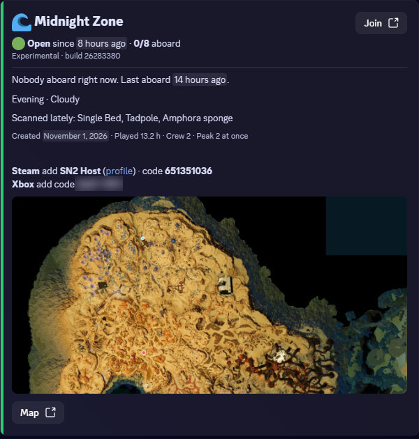
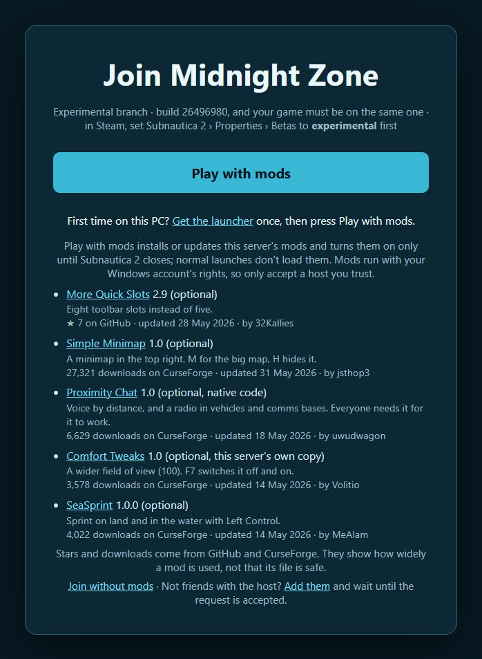

# Moonpool

Keep your Subnautica 2 world online so friends can play when the host can't

Moonpool runs the real game in Docker on a spare PC or server, hosts your world on a Steam account of its own and keeps it there. No GPU needed

## For your friends

Nothing new to install. They add the hosting account as a Steam friend and press Join Game like any co-op session, or use the join page. The launcher is only for servers that ask for mods

Unofficial. Not affiliated with Unknown Worlds, KRAFTON or Valve. There are no game files in this repo and nothing here is for sale

## What you need

- A Linux box or Docker Desktop with Docker Engine 26 and Compose 2.25 or newer. On Windows run everything here from the WSL shell Docker Desktop uses, since `bin/moonpool` is Python and calls bash
- About 4 cores 8 GB of memory and 40 GB of SSD for 4 players. That's the game's stock limit and the default. You can raise `PLAYER_SLOTS` but it's less proven
- A copy of the game on a Steam account you only use for hosting. Signing that account in anywhere else logs the host out, so it can't be the one you play on
- Your friends need their own copy of the game on Steam. Xbox and Game Pass joining is experimental, see the [guide](docs/operating.md#xbox-and-game-pass-players)

## Start it

Run these in a terminal on the machine that will host the server

```sh
git clone --branch v0.3.13 --depth 1 https://github.com/moonpool-server/moonpool.git && cd moonpool
cp .env.example .env
docker compose up -d --build
```

Open `http://127.0.0.1:8080/vnc.html` with the password `bin/moonpool diag viewer` shows and sign in to Steam once. From another machine tunnel it first with `ssh -L 8080:127.0.0.1:8080 you@server`

The game downloads and the world comes up on its own. That can take a while and the log shows how far along it is

```sh
docker compose logs -f sn2
docker compose ps
```

It's ready when `bin/moonpool status` says it's hosting. `docker compose ps` saying healthy means Steam and the game process are up, not that a world is hosted. Invite each friend with `bin/moonpool players invite <their steamid64 or profile link>`. They send the hosting account a Steam friend request and it's accepted within a minute: Moonpool reads the Steam client's own web session out of the data volume and answers as the host account, and `AUTO_ACCEPT_FRIENDS=0` turns that off so you accept in the viewer. Then they hit Join Game or use the page at `http://<server>:8081/join`

Anyone already friends with the hosting account can join too, so use a fresh account or remove them. Want anyone who finds the account to get in? Set `ALLOWLIST_ONLY=false`

The Discord card and the join page, as players see them





## Bring your world

Already playing a world in co-op? Zip the save from the PC that hosted it and move it over. Moonpool waits for the game to confirm it loaded, and puts the old world back if it can't

```sh
bin/moonpool server import savegame_2.zip
bin/moonpool server export          # a zip to take it home again
```

Where the save lives and which builds load is in the [guide](docs/operating.md#bring-your-world)

## What's exposed

- Port 8081 (`SN2_MODS_PORT`) serves the join page and the signed mod list on every interface by default because players without a tunnel need it. It shows the host account's Steam id and the current lobby id, which Steam shows the host's friends anyway. `MODS_BIND=127.0.0.1` closes it when you use the tunnel. The first time a player presses Play with mods their launcher saves this server's signing key from that address and holds every later list to it, so over plain http that first fetch trusts the network; the launcher allows http only on a private network and anything else needs the tunnel or HTTPS. `PUBLISH_CARD=true` adds `/card.json`, what the Discord card shows, player names included
- With `WEB_MAP=true` the map page shows explored areas and base positions to anyone with the link
- The viewer on 8080 controls the signed-in Steam so it listens on this machine only unless you set `VIEWER_BIND` and a password
- The data volume holds the hosting account's Steam session. Keep it and your backups private

## What you get

- Hosts by itself and comes back after a restart
- More than one world on a machine with `bin/moonpool-instance add`
- Admin from the shell with `bin/moonpool`
- Admin in game by naming a PDA signal `!help`
- Backups you can restore with one command
- A Discord card showing who is on with a join button
- An optional map that charts where players have been
- A clock that holds while the world is empty
- The join page, the map page and the card's wording are yours to change from the data volume

## Mods

Copy [plugins.example.yaml](plugins.example.yaml), paste in each mod's download link and publish

```sh
cp plugins.example.yaml plugins.yaml   # edit it with any editor
bin/moonpool mods publish plugins.yaml
```

Your join page then offers Play with mods

Players install the launcher once, [moonpool-setup.cmd](https://github.com/moonpool-server/moonpool/releases/latest/download/moonpool-setup.cmd) from this repo's releases, which the join page links. It shows them what your server wants, asks before installing anything and asks again when that changes. From then on it keeps them on the exact files you published

Mods run with the player's Windows rights and nobody here reviews them, so only say yes to a host you trust. A saved yes stays until the list changes and a new key at the same address counts as a new server

The launcher comes only from this repo's releases. Setup and every update check its signature and the private key isn't on GitHub. It has no Windows code signing so Windows may warn about it. The setup file itself isn't signed: it comes from GitHub over TLS with a build attestation you can check with `gh attestation verify moonpool-setup.cmd -R moonpool-server/moonpool`, and everything it downloads is held to the release key. To check a copy against its release

```sh
gh attestation verify moonpool.ps1 --repo moonpool-server/moonpool --signer-workflow moonpool-server/moonpool/.github/workflows/ci.yml
```

## Does it work

Tested by hand by the maintainer, with real players joining over the internet on Docker Engine and Docker Desktop, on public build `25400633` and experimental `26283380`. The fix for the crash on join, the mod install through the launcher and moving a world between hosts have had short sessions only. CI runs the code's own tests but not the real game

A game update can break it. If that happens the host says so and the [guide](docs/operating.md) covers what to do. A newer build is unproven until a host comes up on it

## More

- [Running Moonpool](docs/operating.md) for sizing, mods, backups and troubleshooting
- Settings are in [.env.example](.env.example) and commands in `bin/moonpool help`

## Questions and security

CONTACT: [issues](https://github.com/moonpool-server/moonpool/issues) for questions and project concerns and [private reporting](https://github.com/moonpool-server/moonpool/security/advisories/new) for security problems. Rights holders can use issues for takedown requests

## Contributing

Issues and pull requests are welcome, see [CONTRIBUTING.md](CONTRIBUTING.md). `pre-commit run --all-files` runs the same checks as CI. Please don't commit game files, Steam sessions, logs or anything generated from the game

## Legal and risk

Moonpool's own code is MIT licensed so you can reuse it. That licence covers only this code. The game and Steam have their own terms and MIT can't change those

Owning the game doesn't override the game's or Steam's terms and nothing here changes that. Read both sets of terms before you run it

The [Subnautica 2 EULA](https://store.steampowered.com/eula/1962700_eula_0) is with KRAFTON. It limits the game to personal non-commercial use. It bars modifying the game and using it with unauthorized software, bots or scripts and it says breaking its terms can end your licence. Moonpool loads a mod into the game so running it goes against those terms as written

The [Steam Subscriber Agreement](https://store.steampowered.com/subscriber_agreement/) applies too. Without Valve's written consent section 2.G restricts modifying Steam content, and hosting or matchmaking through emulation, tunneling, added components or similar tools. Section 4.B restricts tampering with how Steam content runs. Section 4.C restricts scripts and bots that interact with Steam content. An unattended host, scripted clicks in the viewer and automatic friend accepting are the kind of automation those sections describe, and this project has no consent from Valve

Unknown Worlds doesn't officially support mods yet. KRAFTON, Unknown Worlds or Valve could act against this project or the hosting account. Use a spare account you can afford to lose and decide for yourself. This isn't legal advice

We try to stay out of the studio's way. Moonpool ships no game files, no data taken from them and none of the game's art. Its code does name objects in the game so it can call them. Its own commands don't spawn items or teleport anyone, and the game's console is reachable from the host only if you turn that on. It hosts four players by default, the game's own limit. If something breaks take mods out and check the game alone before you report anything to Unknown Worlds, and report Moonpool problems here

If Unknown Worlds or KRAFTON ask us to change or stop something we'll do it. If an official dedicated server covers what this does we'll point people to it

This project doesn't sell hosting and asks you not to. That's a stance and a way to reduce that risk, not a limit in the licence

Don't share or rent accounts
