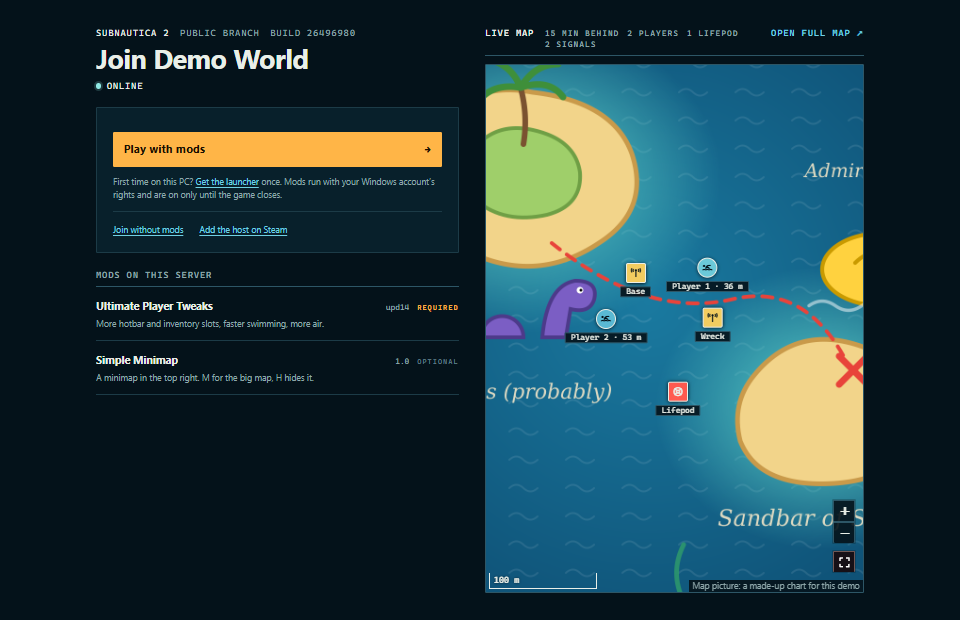
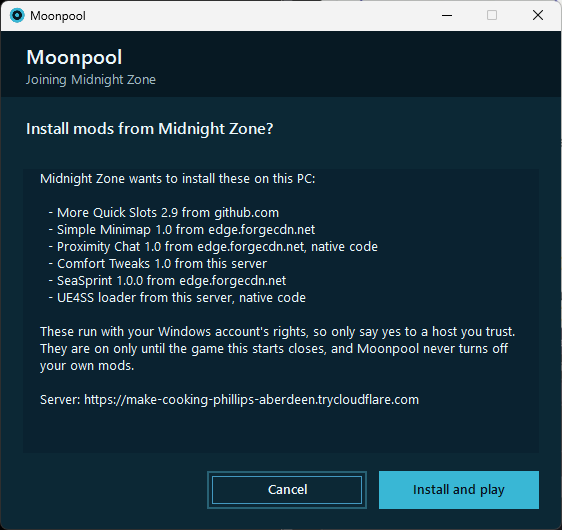

# Moonpool

Keeps your Subnautica 2 world online so friends can play when you can't.

Moonpool runs the real game under Wine in Docker, on a spare PC or a server, signed in to a Steam account of its own. No GPU needed.

Unofficial. Not affiliated with Unknown Worlds, KRAFTON or Valve. No game files in this repo, and nothing here is for sale.




## For your friends

They add the hosting account as a Steam friend and press Join Game, or open the join page. Nothing to install unless the server uses mods.

## What you need

- Docker Engine 26 and Compose 2.25 or newer, on Linux or Docker Desktop. On Windows, `bin/moonpool` runs from PowerShell with Python 3.8+ installed as `python`; `bin/moonpool-instance` and the shell commands below need Docker Desktop's WSL shell.
- For 4 players: about 4 cores, 8 GB of memory and 40 GB of SSD. Four is the game's limit and the default (`PLAYER_SLOTS` raises it; less tested).
- A Steam account that owns the game and is used only for hosting. Signing it in anywhere else logs the host out.
- Friends need their own copy on Steam. Xbox and Game Pass joining is experimental ([guide](docs/operating.md#xbox-and-game-pass-players)).

## Start it

```sh
git clone https://github.com/moonpool-server/moonpool.git
cd moonpool
git checkout "$(git describe --tags --abbrev=0)"
cp .env.example .env
docker compose up -d --build
```

1. Open `http://127.0.0.1:8080/vnc.html` and sign in to Steam once. `bin/moonpool diag viewer` shows the password. From another machine: `ssh -L 8080:127.0.0.1:8080 you@server`.
2. Wait for the game to download and the world to load (`docker compose logs -f sn2`). Accept any licence prompt yourself in the viewer; Moonpool only clicks Steam's install and location prompts.
3. `bin/moonpool status` says when it's hosting. `docker compose ps` showing healthy only means Steam and the game are running.
4. Invite each friend: `bin/moonpool players invite <steamid64 or profile link>`. They send the hosting account a friend request; accept it in the viewer, or set `AUTO_ACCEPT_FRIENDS=1` to have invited players accepted within a minute.
5. Friends press Join Game, or open `http://<server>:8081/join`.

Anyone already friends with the hosting account can join too. `ALLOWLIST_ONLY=false` lets in anyone who finds it.

## Bring your world

```sh
bin/moonpool server import SaveGames.zip   # a world from the PC that hosted it
bin/moonpool server export                 # a zip of the hosted world
```

Import puts the old world back if the game can't load the new one. The [guide](docs/operating.md#bring-your-world) says where saves are and which builds load them.

## Mods

```sh
cp plugins.example.yaml plugins.yaml   # list each mod with its download link
bin/moonpool mods publish plugins.yaml
```

The join page then offers Play with mods. Players install the launcher once, from [moonpool-setup.cmd](https://github.com/moonpool-server/moonpool/releases/latest/download/moonpool-setup.cmd). Before installing anything new it shows each mod and the site it comes from, and asks. Each download is checked against the hash in the server's signed mod list, and placed files are checked again on later runs.



- Mods are on only while the game the launcher started is running. A normal Steam launch loads none.
- If the launcher is killed mid-game, they stay on until its next run or the "Subnautica 2 (without Moonpool mods)" shortcut.
- The player's own mods are left alone. Exceptions: a `UE4SS_Signatures` folder the server didn't send is moved aside while Moonpool's mods are on, and a loader installed another way is replaced only after asking, with a copy in `%LOCALAPPDATA%\Moonpool-replaced`.
- For the session it adds two settings to the game's `Engine.ini`, removed when the game closes; a value the player set is kept. `r.ShaderPipelineCache.BackgroundBatchSize=100` cut the wait before joining from about 3 minutes to 7 seconds on a test PC. `ConfiguredInternetSpeed` and `ConfiguredLanSpeed=300000` cut loading from 30 s to 15 s.
- Xbox and Game Pass players join without mods.

Mods run with the player's Windows rights and nobody here reviews them. Accept mods only from a host you trust. A new signing key at the same address counts as a new server.

Uninstall (close the game first; the [guide](docs/operating.md#mods) lists what it removes):

```powershell
powershell -ExecutionPolicy Bypass -File "$env:LOCALAPPDATA\Moonpool\moonpool.ps1" -Uninstall
```

### Checking the launcher

Setup and every update check the launcher's signature against a release key that isn't on GitHub. Neither the launcher nor the setup file has Windows code signing, so Windows may warn. Both carry a GitHub build attestation:

```sh
gh attestation verify moonpool-setup.cmd -R moonpool-server/moonpool
gh attestation verify moonpool.ps1 --repo moonpool-server/moonpool --signer-workflow moonpool-server/moonpool/.github/workflows/ci.yml
```

Each release lists `moonpool-SHA256SUMS.txt`; compare `Get-FileHash moonpool-setup.cmd` against it. Setup runs PowerShell with `-ExecutionPolicy Bypass`, a PowerShell script setting that doesn't touch Defender. Never turn Defender or SmartScreen off for it.

## What's exposed

- **Port 8081** (`SN2_MODS_PORT`): the join page and the signed mod list, on every interface by default. It shows the host account's Steam ID and the lobby ID. `MODS_BIND=127.0.0.1` closes it when you use the tunnel. `PUBLISH_CARD=true` adds `/card.json` with the Discord card's contents, player names included.
- **The first mod download.** The launcher saves the server's signing key on first contact and holds later lists to it. Plain http is allowed only on a private network; elsewhere use the tunnel or HTTPS.
- **The map** (`WEB_MAP=true`): anyone with the link sees where each player was 15 minutes ago and the PDA signals everyone in game can see. Players show as "Player 1" etc. unless `MAP_PLAYER_NAMES=true`.
- **The viewer on 8080** controls the signed-in Steam client. It listens on this machine only unless `VIEWER_BIND` is set, and always has a password. Reach it with Tailscale or `ssh -L`, never a forwarded port.
- **The volumes** hold the hosting account's Steam session and the key that signs your mod list. Moonpool reads that session to look up the lobby ID, and to accept friend requests when `AUTO_ACCEPT_FRIENDS=1`. Keep the volumes and your backups private.

## Features

- Hosts by itself and comes back after a restart
- Several worlds on one machine (`bin/moonpool-instance add`)
- Admin from the shell (`bin/moonpool`) and in game (name a PDA signal `!help`)
- One-command restore from backups
- A Discord card with who's on and a Join button
- An optional map of where everyone was a few minutes ago
- An idle mode (friends preset): the clock stops and the frame rate drops while nobody is on
- Your own wording for the join page, map page and card

## Tested builds

Tested by hand with real players over the internet. CI runs Moonpool's own tests, not the game.

| Branch | Build | Result |
|---|---|---|
| public | `25400633` | Hosts, players join |
| experimental | `26283380` | Hosts, players join with mods, world moved between hosts (short sessions) |
| experimental | `26496980` | Hosts with UE4SS 1190 and two layout files ([Updates](docs/operating.md#updates)); players join with mods |

A game update can stop hosting; the host reports it and the [guide](docs/operating.md#updates) says what to do. Tried another build? Open an issue.

## More

- [Running Moonpool](docs/operating.md): sizing, mods, backups, troubleshooting.
- Settings: [.env.example](.env.example). Commands: `bin/moonpool help`.

## Questions and security

Contact: [issues](https://github.com/moonpool-server/moonpool/issues) for questions, [private reporting](https://github.com/moonpool-server/moonpool/security/advisories/new) for security problems. Rights holders wanting a takedown can open an issue asking for a private contact.

## Contributing

See [CONTRIBUTING.md](CONTRIBUTING.md). `pre-commit run --all-files` runs the CI checks. Don't commit game files, Steam sessions, logs or anything generated from the game.

## Legal and risk

Moonpool's code is MIT licensed. That covers this code only, not Subnautica 2 or Steam. Not legal advice.

- The [Subnautica 2 EULA](https://store.steampowered.com/eula/1962700_eula_0) limits the game to personal, non-commercial use and bars modifying it or using it with unauthorized software, bots or scripts; breaking it can end your licence. Moonpool loads a mod and automates hosting, so running it appears to conflict with those terms.
- The [Steam Subscriber Agreement](https://store.steampowered.com/subscriber_agreement/) section 2.G restricts modifying Steam content and hosting through emulation, tunneling or added components without Valve's written consent; 4.B restricts tampering with how Steam content runs; 4.C restricts scripts and bots that interact with it.
- Unknown Worlds, KRAFTON and Valve haven't consented to this project, and Unknown Worlds doesn't officially support mods yet. The hosting account could lose the game or face action on Steam. Host on an account you can afford to lose; that limits the loss, it doesn't make the use permitted.

Moonpool ships no game files, no data taken from them and none of the game's art; its code names game objects so it can call them. Its own commands don't spawn items or move players. The default `friends` preset runs the game's `Unlock` command as each joining player so everyone shares the host's unlocks (`PRESET=stock` turns it off). In-game admins can run other console commands only if you enable it. Layout files a host puts in `ue4ss-client/` are measured from the game and served to anyone who can reach its join page ([guide](docs/operating.md)).

If something breaks, test the game without mods before reporting to Unknown Worlds; report Moonpool problems here. If Unknown Worlds or KRAFTON ask us to change or stop something, we will. If an official dedicated server covers this, we'll point people to it.

Please don't sell hosting or share or rent accounts.
