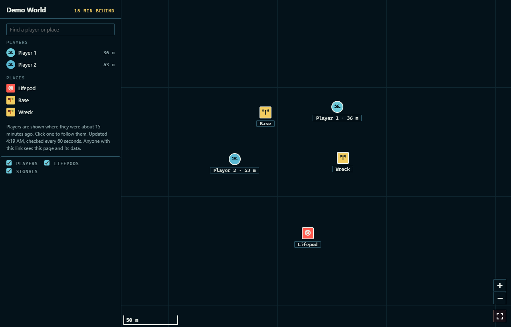
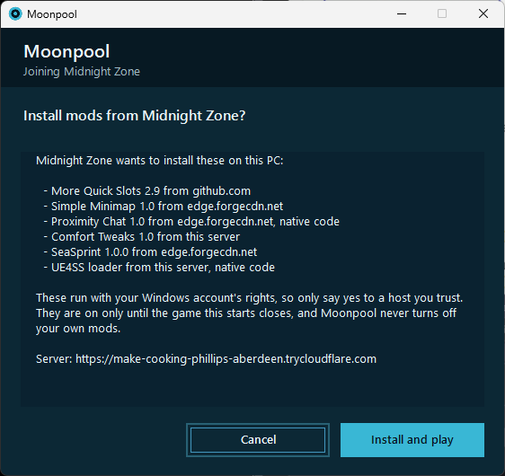

# Moonpool

Keep your Subnautica 2 world online so friends can play when the host can't.

Moonpool runs the real game under Wine in Docker, on a spare PC or a server. It hosts your world on a Steam account of its own and keeps it up. No GPU needed.

Moonpool is unofficial and not affiliated with Unknown Worlds, KRAFTON or Valve. This repo contains no game files, and nothing here is for sale.




## For your friends

Nothing to install unless your server uses mods. They add the hosting account as a Steam friend and press Join Game like any co-op session, or open the join page.

## What you need

- Docker Engine 26 and Compose 2.25 or newer, on Linux or through Docker Desktop. On Windows, `bin/moonpool` also runs from PowerShell if Python 3.8 or newer is installed as `python`. `bin/moonpool-instance` and the shell commands below need the WSL shell that Docker Desktop uses.
- About 4 cores, 8 GB of memory and 40 GB of SSD for 4 players. Four is the game's stock limit and the default. You can raise `PLAYER_SLOTS`, but bigger sessions are less tested.
- A copy of the game on a Steam account used only for hosting. Signing that account in anywhere else logs the host out, so it can't be the account you play on.
- Friends need their own copy of the game on Steam. Xbox and Game Pass joining is experimental; see the [guide](docs/operating.md#xbox-and-game-pass-players).

## Start it

On the machine that will host:

```sh
git clone https://github.com/moonpool-server/moonpool.git
cd moonpool
git checkout "$(git describe --tags --abbrev=0)"
cp .env.example .env
docker compose up -d --build
```

1. Open `http://127.0.0.1:8080/vnc.html` and sign in to Steam once. `bin/moonpool diag viewer` shows the password. From another machine, tunnel first with `ssh -L 8080:127.0.0.1:8080 you@server`.
2. Wait for the game to download and the world to come up. This can take a while; `docker compose logs -f sn2` shows progress. If Steam or the game asks you to accept a licence on first install, accept it in the viewer. Moonpool's install helper skips any window whose title names a licence or EULA; it clicks only Steam's install and location prompts, recognised by their titles.
3. Run `bin/moonpool status`. The server is ready when it says it's hosting. `docker compose ps` showing healthy only means Steam and the game process are running.
4. Invite each friend with `bin/moonpool players invite <their steamid64 or profile link>`. They send the hosting account a friend request and you accept it in the viewer. With `AUTO_ACCEPT_FRIENDS=1`, Moonpool accepts invited players within a minute and acts as the host account to do it. Either way it reads the Steam client's web session from the data volume, to look up the lobby id for the join page.
5. Friends press Join Game, or use the page at `http://<server>:8081/join`.

Anyone already friends with the hosting account can join too, so start with a fresh account or remove them. To let in anyone who finds the account, set `ALLOWLIST_ONLY=false`.

## Bring your world

Already playing a world in co-op? Zip the save on the PC that hosted it and import it. Moonpool waits for the game to confirm the world loaded, and puts the old one back if it doesn't.

```sh
bin/moonpool server import savegame_2.zip
bin/moonpool server export          # a zip to take it home again
```

The [guide](docs/operating.md#bring-your-world) says where the save lives and which builds load it.

## Mods

List your mods in `plugins.yaml`, starting from [plugins.example.yaml](plugins.example.yaml). Each entry needs the mod's download link. Then publish:

```sh
cp plugins.example.yaml plugins.yaml   # edit it with any editor
bin/moonpool mods publish plugins.yaml
```

The join page then offers Play with mods. Players install the Moonpool launcher once, from [moonpool-setup.cmd](https://github.com/moonpool-server/moonpool/releases/latest/download/moonpool-setup.cmd) in this repo's releases; the join page links it. When they press Play with mods and the list has something they haven't accepted, the launcher shows the mods with the site each one downloads from, marks the new and changed ones, and asks before installing them. It then shows its progress, keeps them on the exact files you published, and starts the game through Steam.



The mods are on only while the game the launcher started is running, so a normal Steam launch loads none of them. When the game closes, the launcher turns them off again, and says so if a file was still in use. If the launcher is killed mid-game, they stay on until its next run or until the player uses the "Subnautica 2 (without Moonpool mods)" shortcut. The player's own mods are left alone, with two exceptions: a `UE4SS_Signatures` folder the server didn't send is moved aside while Moonpool's mods are on and put back after, and a loader the player installed another way is replaced only after asking, with a copy kept in `%LOCALAPPDATA%\Moonpool-replaced`. Xbox and Game Pass players join without mods.

Mods run with the player's Windows rights and nobody here reviews them, so players should accept mods only from a host they trust. An accepted list stays accepted until it changes, and a new signing key at the same address counts as a new server.

To remove the launcher and what it placed, close the game and run this in PowerShell. The guide's [Mods](docs/operating.md#mods) section lists what it removes and what it leaves.

```powershell
powershell -ExecutionPolicy Bypass -File "$env:LOCALAPPDATA\Moonpool\moonpool.ps1" -Uninstall
```

### Checking the launcher

The launcher comes only from this repo's releases. Setup and every update check its signature against a release key whose private half isn't on GitHub. The launcher has no Windows code signing, so Windows may warn about it.

The setup file itself isn't signed. It comes from GitHub over TLS with a build attestation, and everything it downloads is held to the release key. To check a copy:

```sh
gh attestation verify moonpool-setup.cmd -R moonpool-server/moonpool
gh attestation verify moonpool.ps1 --repo moonpool-server/moonpool --signer-workflow moonpool-server/moonpool/.github/workflows/ci.yml
```

Each release also lists `moonpool-SHA256SUMS.txt`, under the same attestation. To install by hand, compare `Get-FileHash moonpool-setup.cmd` with that list before you run it.

Setup runs PowerShell with `-ExecutionPolicy Bypass` so the downloaded launcher can start. That's a PowerShell script setting; it doesn't disable or bypass Defender. Never turn Defender or SmartScreen off for it.

Releases come often while the project is young. Each one passes CI and carries those attestations. There's no separate stable channel yet.

## What's exposed

- **Port 8081** (`SN2_MODS_PORT`) serves the join page and the signed mod list. It listens on every interface by default, because players without a tunnel need it. The page shows the host account's Steam ID and the current lobby ID, which Steam already shows the host's friends. `MODS_BIND=127.0.0.1` closes it when you use the tunnel. `PUBLISH_CARD=true` adds `/card.json`, which holds what the Discord card shows, player names included.
- **The first mod download.** The first time a player presses Play with mods, the launcher saves this server's signing key from that address and holds every later list to it. Over plain http that first fetch trusts the network, so the launcher allows http only on a private network. Anywhere else needs the tunnel or HTTPS.
- **The map.** With `WEB_MAP=true`, the map page shows anyone with the link where each player was 15 minutes ago, and the PDA signals everyone in the game can see. Players are numbered ("Player 1") unless you set `MAP_PLAYER_NAMES=true`.
- **The viewer on 8080** controls the signed-in Steam client, so it listens on this machine only unless you set `VIEWER_BIND`. It always has a password: `VNC_PASSWORD`, or one made at first start that `bin/moonpool diag viewer` shows. To reach it from elsewhere, use Tailscale or `ssh -L 8080:localhost:8080 <server>`, never a forwarded port.
- **The data volume** holds the hosting account's Steam session, and a second volume holds the key that signs your mod list. Keep both and your backups private.

## Features

- Hosts by itself and comes back after a restart
- More than one world on a machine, with `bin/moonpool-instance add`
- Admin from the shell with `bin/moonpool`, and in game by naming a PDA signal `!help`
- Backups you can restore with one command
- A Discord card showing who's on, with a Join button
- An optional map of where everyone was a few minutes ago, with lifepods and named signals
- A game clock that stops while the world is empty
- Your own wording for the join page, the map page and the card, set from the data volume

## Does it work

The maintainer tests by hand, with real players joining over the internet, on Docker Engine and Docker Desktop. CI runs Moonpool's own tests, not the real game. Results by game build:

| Branch | Build | Result |
|---|---|---|
| public | `25400633` | Hosted; real players joined over the internet |
| experimental | `26283380` | Hosted; real players joined over the internet. Joining with mods through the launcher and moving the world between two hosts also worked, in short sessions |
| experimental | `26496980` (seen 9 November 2026) | Hosted with UE4SS 1190 and two layout files in `ue4ss-local`; the guide's [Updates](docs/operating.md#updates) section says which. Real players joined over the internet with mods through the launcher |

A game update can stop hosting: the newest build above hosted only once it had those two files. The host reports it when that happens, and the [guide](docs/operating.md) covers what to do. Treat a newer build as unproven until a host comes up on it. The table records only the maintainer's runs, so if you try a build, an issue saying what happened is the most useful thing you can send.

## More

- [Running Moonpool](docs/operating.md) covers sizing, mods, backups and troubleshooting.
- Settings are in [.env.example](.env.example), and `bin/moonpool help` lists the commands.

## Questions and security

Contact: [issues](https://github.com/moonpool-server/moonpool/issues) for questions and concerns, and [private reporting](https://github.com/moonpool-server/moonpool/security/advisories/new) for security problems. Rights holders asking for a takedown can open an issue asking for a private contact; please leave confidential material out of it.

## Contributing

Issues and pull requests are welcome; see [CONTRIBUTING.md](CONTRIBUTING.md). `pre-commit run --all-files` runs the same checks as CI. Please don't commit game files, Steam sessions, logs or anything generated from the game.

## Legal and risk

Moonpool's code is MIT licensed. That licence covers only this code, not Subnautica 2 or Steam. This isn't legal advice.

The [Subnautica 2 EULA](https://store.steampowered.com/eula/1962700_eula_0) is with KRAFTON. It limits the game to personal, non-commercial use, bars modifying the game and using it with unauthorized software, bots or scripts, and says breaking its terms can end your licence. Moonpool loads a mod and automates hosting, so running it appears to conflict with those terms.

The [Steam Subscriber Agreement](https://store.steampowered.com/subscriber_agreement/) applies too. Without Valve's written consent, section 2.G restricts modifying Steam content and hosting or matchmaking through emulation, tunneling, added components or similar tools. Section 4.B restricts tampering with how Steam content runs, and section 4.C restricts scripts and bots that interact with Steam content.

Unknown Worlds, KRAFTON and Valve haven't consented to this project, and Unknown Worlds doesn't officially support mods yet. What's at risk is the hosting account: it could lose the game or face action on its Steam account. Host on a separate account you can afford to lose. That limits what you could lose; it doesn't make the use permitted.

There's no dedicated-server program, so Moonpool runs the normal game under Wine, and each world needs its own Steam account that owns the game.

Moonpool ships no game files, no data taken from them and none of the game's art. Its code does name objects in the game so it can call them. Its own commands don't spawn items or move players. The default `friends` preset does run the game's own `Unlock` console command as each joining player, so everyone shares the host's unlocks; `PRESET=stock` turns that off. In-game admins can run other console commands only if you turn that on. A host that puts layout files in `ue4ss-client/` serves them, measured from the game, to anyone who can reach its join page, inside the loader download (docs/operating.md). It hosts four players by default, the game's own limit. If something breaks, take mods out and check the game alone before you report anything to Unknown Worlds. Report Moonpool problems here.

If Unknown Worlds or KRAFTON ask us to change or stop something, we'll do it. If an official dedicated server covers what Moonpool does, we'll point people to it.

This project doesn't sell hosting and asks you not to. The licence doesn't forbid it; the request is there to keep the risks above as small as they can be. Don't share or rent accounts.
