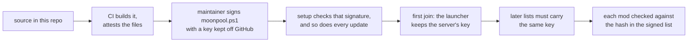

# Security

| | |
|---|---|
| Report | privately at https://github.com/moonpool-server/moonpool/security/advisories/new, not in a public issue. Say what you found and how to reproduce it |
| Fixes | in the next release; older releases get none |
| Response | one person reads these: expect days, not hours, and no promised date |

## Checking the launcher yourself

- Setup and every update check the launcher's signature against the release key, which isn't on GitHub.
- Neither file has Windows code signing, so Windows may warn. Both carry a GitHub build attestation:

```sh
gh attestation verify moonpool-setup.cmd -R moonpool-server/moonpool
gh attestation verify moonpool.ps1 --repo moonpool-server/moonpool --signer-workflow moonpool-server/moonpool/.github/workflows/ci.yml
```

- Each release lists `moonpool-SHA256SUMS.txt`; compare `Get-FileHash moonpool-setup.cmd` against it.
- Setup runs PowerShell with `-ExecutionPolicy Bypass`, a PowerShell script setting that doesn't touch Defender. **Never turn Defender or SmartScreen off for it.**

## What to expect from it

How a player's launcher comes to trust a server's mods:



- **How a player's launcher is trusted.**
  1. The source is in this repository. `.github/workflows/ci.yml` builds it and attaches a GitHub build attestation to `moonpool-setup.cmd`, `moonpool.ps1` and `moonpool-SHA256SUMS.txt`.
  2. The maintainer signs `moonpool.ps1` on their own machine, with a key kept off GitHub, and publishes the release.
  3. Setup downloads the launcher and its signature from this repository's latest release and checks the signature with the public key it carries before running it. The launcher does the same on every update.
  4. On a player's first join the launcher saves the server's key from its `moonpool.json`. A different key at the same address counts as a new server, and the player is asked before any mod is installed.
  5. Each mod archive is checked against the hash in the signed list (sha256, or the sha1 or md5 CurseForge publishes) before it is unpacked. Every placed file is recorded with its sha256 and checked again on later runs.
- **What the launcher touches on Windows.** It runs as the signed-in user and never asks for administrator rights.
  - Its own folder `%LOCALAPPDATA%\Moonpool`: the launcher, the ledger of placed files, one folder per server.
  - The registry key `HKCU\Software\Classes\moonpool`, so `moonpool:` links open it.
  - Shortcuts named `Subnautica 2 (...)` on the Desktop and in the Start menu.
  - In the game's install: `Subnautica2\Binaries\Win64` (the loader `dwmapi.dll` and the `ue4ss` folder) and `Subnautica2\Content\Paks\~mods`. While Moonpool's mods are on, a `UE4SS_Signatures` folder the server didn't send is moved aside, and put back when they go off.
  - For each session, two settings in `Subnautica2\Saved\Config\Windows\Engine.ini`, marked as its own and removed when the mods go off.
  - Downloads and setup go through `%TEMP%`.
  - It reads `HKCU\Software\Valve\Steam` and Steam's `libraryfolders.vdf` and `appmanifest` files to find the game.
  - `-Uninstall` removes the game files it placed that are unchanged, the handler and shortcuts that still point at it, and all of `%LOCALAPPDATA%\Moonpool`. It leaves what setup put in `%TEMP%`, and the copies in `%LOCALAPPDATA%\Moonpool-replaced` of the player's files it replaced after asking.
- **One user, no capabilities.** Steam, the game, UE4SS and the host's mods run in the game container as one unprivileged user with every Linux capability dropped. A server mod can read anything that user can.
- **The volumes are the secret.** The data volume holds the hosting account's Steam sign-in and the viewer password. The mod-list signing key has its own volume, mounted at `mod-signing/`, so the data volume can be rebuilt without players seeing a new server. Both are mounted in the game container; anything running there can read both. Anyone with the data volume can sign in as the hosting account. Never host on your own Steam account.
- **Secrets in `.env`.**
  - The tunnel token is blanked in the game container and removed before anything in it starts.
  - `DISCORD_WEBHOOK_URL` and `CURSEFORGE_API_KEY` reach the game container, which posts the card and publishes mods.
  - The Steam client and the game, and so any mod the game loads, start without those two, `GITHUB_TOKEN`, `VNC_PASSWORD` and `STEAM_BRANCH_PASSWORD` in their environment. The container's other services still have them.
  - That keeps them out of the game's crash dumps and child processes, not out of a mod's reach. Every service runs as the same user, so a host mod (UE4SS Lua can run programs) can read the volume, the Steam session, the mod-signing key and the other services' environment. Only run host mods you trust.
- **Backups.** The backup container runs as its upstream image's default user, root. It sees the save staging folder read-only and the backups folder, reads `backup.env` and only the `BACKUP_*` values compose passes it (never `.env` as a whole), and gets no Steam session.
- **The map** (`WEB_MAP=true`) is public data: `map.json` holds everything the page draws. The fog is a view, not a lock. `MAP_PLAYERS=false` leaves out players and where anyone has been; `MAP_SIGNALS=false` leaves out the PDA signals everyone in game can see.
- **What listens.** The viewer (8080) listens on this machine only unless `VIEWER_BIND` says otherwise, and always has a password. Port 8081 is public on purpose: it serves one folder of static files (the join page, the signed mod list, the mod files and, when on, the map and the card) and runs no code for a request.
- **What 8081 shows.** The join page shows the host account's Steam ID and the lobby ID. `PUBLISH_CARD=true` adds `/card.json` with the Discord card's contents, player names included.
- **The first mod download.** The launcher saves the server's signing key on first contact and holds later lists to it, so the first connection is trusted on first use. Plain http is allowed only on a private network; elsewhere use the tunnel or HTTPS.
- **The Steam web session.** `scripts/friend-accept.py` reads two cookies, `sessionid` and `steamLoginSecure`, from the Steam client's cookie store in the volume and sends them only to `steamcommunity.com`, fixed in the code. The web API token that session hands out goes only to `api.steampowered.com`. Without `AUTO_ACCEPT_FRIENDS=1` it only reads (the lobby id and the count of waiting friend requests); with it, it also accepts invited players and removes banned ones. It never prints a cookie.
- **Who it talks to.** Moonpool's own code sends nothing to its maintainers. It can't speak for Steam, the game, UE4SS or the mods you add.

  | Destination | From | Why | When |
  |---|---|---|---|
  | Steam | the Steam client and the game | sign-in, game updates, the hosted session | always |
  | `steamcommunity.com`, `api.steampowered.com` | `scripts/friend-accept.py`, as the hosting account | read its own lobby id for the join page | when the game log doesn't carry it (it doesn't on the public branch) |
  | the same | the same | read pending friend requests, and with `SHOW_PLAYER_NAMES=true` those players' profile names | `AUTO_ACCEPT_FRIENDS=0` |
  | the same | the same | accept invited players and remove banned ones from its friends | `AUTO_ACCEPT_FRIENDS=1` |
  | Cloudflare | `cloudflared` | carries the join page and mod files | a tunnel is on |
  | Discord | the game container | posts and edits the card | a webhook is set |
  | GitHub | the game container | the pinned UE4SS archive | installing the loader |
  | Valve's CDN | the game container | `SteamSetup.exe` | first start |
  | Microsoft (`aka.ms`) | the game container | the Visual C++ runtime | when `NATIVE_MSVC` asks for it |
  | GitHub, CurseForge | the game container | the mods you list, and their stars, downloads, dates and authors | publishing mods; stats at most every six hours |
  | the servers in `DISCORD_BOARD_PEERS` | the game container | their status for the card | a peer is set |
  | the map picture addresses you set | the game container, https only | the pictures behind the map and its still | `WEB_MAP=true` with a picture set |
  | cdnjs.cloudflare.com, cdn.jsdelivr.net | the map viewer's browser | the page's scripts and icon font | the map page is opened |
  | the map's tile host | the map viewer's browser | the map tiles | the map page is opened with tiles set |

  The server never fetches Nexus Mods files: the host pins them and players download them.
- **If the volume leaks.** Change the hosting account's Steam password and use "Deauthorize all other devices" under Steam Guard, so the stored session stops working. Delete `mod-signing/private.pem` and `viewer-password` in the container: the next publish makes a new mod-signing key and the next start a new viewer password (if `VNC_PASSWORD` in `.env` sets one, change it there). Players' launchers then treat the server as new and ask again, warning that the address had a different key.
- **The UE4SS mirror.** The two archives in the `ue4ss-mirror` release are byte-identical to the same-named assets on UE4SS's `experimental` release. [NOTICE](NOTICE) lists both SHA-256 values, which `scripts/common.sh` pins. To check: `gh api repos/UE4SS-RE/RE-UE4SS/releases/tags/experimental --jq '.assets[] | .name + " " + .digest'`.
- **History.** History before v0.4.0 (10 November 2026, four days after going public) was squashed into one commit, and the test releases v0.2.x and v0.3.x were removed. From v0.4.0 on, history is kept. Release tags aren't signed with a git key; each release's launcher is signed with the release key and attested by the build.
- **Two keys.** The release key signs the launcher; the setup file carries its public half and a build attestation, and isn't signed itself. Each server's own key signs that server's mod list, so a launcher knows the list came from the server the player accepted. That doesn't mean anyone reviewed the mods.

## Known vulnerabilities in the image

- The game image is Debian trixie plus Wine, which pulls in a few hundred libraries.
- Grype, in the `Docker build` CI job, lists many High and Critical entries. At the last revision of this section, every finding was in a Debian package with no Debian fix (won't-fix or not fixed yet).
- That can change with any Debian advisory; the latest `Docker build` run's step summary has the current list.

- CI fails on a Critical finding that has a fix, and prints every High and Critical finding, fixed or not, in the step summary.
- Before a release the maintainer is expected to read that list and remove what Moonpool doesn't need. CI doesn't check this.
- noVNC comes from its own release archive, pinned by sha256, not Debian's package, which would bring Node.js. Node isn't installed; websockify (Python) serves the viewer's files.
- Pillow, which decodes the map pictures from addresses the host sets, comes from its PyPI wheel (13.0.0, pinned by sha256), not Debian's 11.1, whose decoder findings Debian doesn't patch.
- Listeners: lighttpd on 8081 (published as `MODS_BIND` says, every interface by default), websockify on the viewer port (published at `127.0.0.1` unless `VIEWER_BIND` says otherwise), and x11vnc on the container's loopback only.
- Parsed input: Moonpool's Python parses answers from Steam (friend requests), Discord, the listed peer servers, GitHub and CurseForge (mod metadata, archives and stats), the tunnel's metrics endpoint, and the map picture addresses the host set, decoded by Pillow. Which process loads which listed library isn't recorded here.

If you think a finding matters more than this says, report it as above.
