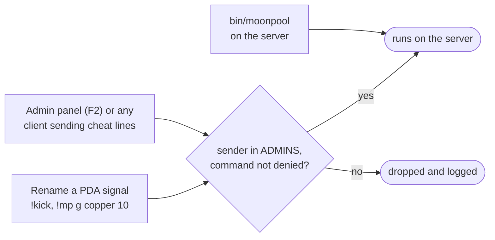

# In-game admin

Orders from inside the game pass one gate on the server. The server's own shell needs none:



## Who is an admin

Admins are listed by Epic ID, the `eos=` value the UE4SS log prints as each player joins (`player NAME eos=...`):

| Where | Read |
|---|---|
| `ADMINS` in `.env` | at start |
| `control/admins.txt` in the data volume | while running; one per line, text after a space is a note, `#` starts a comment |

Names and Steam IDs don't count, because a client can claim those.

## Orders through a PDA signal

Nothing to install: rename any PDA signal to a command.

- The answer comes back in the signal's name (about 40 characters show): green for done, red for refused. It also shows as a notification on the sender's screen.
- A signal renamed by a non-admin is ignored without a reply.

```
!help                 the list
!kick NAME            remove a player
!time 12:00           set the clock
!weather DA_Storm     set the weather
!slots 8              change the player cap
!ping                 where everyone is, for admins; your own spot for anyone
!cmd LINE             one of the game's console commands, run on the host as you
!mp LINE              the admin console; any other word goes there too, so !give copper 10 works
```

`!cmd` and `!mp` need [console commands](#console-commands) turned on.

## The admin console (`!mp`)

`!mp` takes any console line, plus named commands (`give`, `heal`, `who`...) that look names up. The `mp` can be left out unless the line starts with one of the fixed orders above (`!help`, `!time`...). A named command takes the player first, as on most game servers:

| Signal | Does |
|---|---|
| `!give copper wire 10` | gives you the item with that name, 10 of it |
| `!give john copper 5` | gives it to the player whose name starts with john |
| `!give everyone copper` | gives it to every player (`all` works too) |
| `!give 10 titanium ingot` | the name's words and the number in any order, no quotes needed |
| `!give cop` | an unclear name asks: `cop? 1 Copper  2 Copper Ingot  3 Copper Wire` |
| `!2` | ...and a bare number answers it |
| `!heal`, `!heal john`, `!heal all` | health, oxygen, food and water to 100 for you, a player, or everyone |
| `!@john LINE` | any line, run as that player (`@all`, `@host`, `@me`) |
| `!find titan` | items, players and tags by name, with their ids |
| `!list items cop` | one kind, filtered; `!list commands` lists the game's console commands |
| `!cheats` | which cheat tags named in `console.json` are on |
| `!who` | who is on, with their Epic ID and ping |
| `!SomeConsoleCommand 3` | any other line goes to the game as typed |

- A word after `give` counts as a player only when it starts exactly one player's name and the item's name follows it. Otherwise it's part of the item: `!give titanium ingot` gives the ingot even with a player called Titan on. `@` always means a player.
- A named command with a missing part answers with how it's typed: `use: give [player] <item> [count]`.

Words, commands and replies come from `console.json` (shipped: `mod/SN2SlotFreeHost/console.json`). To change them, put a file with only your changed keys in the data volume and recreate the host:

| Key type | In your file |
|---|---|
| objects, such as `commands` | merge with the shipped ones |
| lists, such as `deny` | replace them |

```json
{
  "commands": {
    "full": { "aliases": ["full"], "lines": ["HealMe", "attr oxygen 100"] }
  }
}
```

- `commands` maps a word to console lines. Arguments are looked up by kind; see `give` in the shipped file.
- `on_ambiguous: first` takes the best match without asking.
- `deny` blocks commands that crash or wipe the world, the engine's `DestroyAll`, `DestroyAllPawnsExceptTarget` and `DestroyPawns` among them. `"deny": []` in your own file turns that off.
- Every line runs as one command. The game's console splits a line at `|` and at line breaks, so a line to run with `|`, `;`, a backtick or a control character is refused on every path (`!mp`, `!cmd`, the cheat panel, `ExecuteForAll`). `!cmd` lines are also capped at 128 characters, as `moonpool diag console` lines are.
- `line_gap_ms` (1000) spaces the lines of one order; each can stall the server a second or so.

| Word | Does | Watch out |
|---|---|---|
| `normal` | `DayOnly 0`, then `RemoveGlobalTag` for each tag in `tags`. On the current build every cheat, god mode and invisibility included, is a world tag, so this clears it for everyone | can't undo `FastSwim` (only on the admin's PC; run it again) or `QuickNav`'s fog and speed (the game's `NormalNav`) |
| `god`, `fastbuild` (the game's own) | toggle | ignore a number: `FastBuild 0` turns it on |
| `tag`, `untag` | add or remove a world tag with the `Global` commands | the game's own `AddTag` and `RemoveTag` act on one player and leave the world's cheat on |
| `undo` | removes the nearest thing within `undo.within_m` metres of the admin, of the class their last spawn placed, and says how far away it was | goes by class and distance, so it may remove a copy someone else placed. The last `undo.keep` per admin are kept until restart |

## Macros

The game's macros are text files in `Content/Macros` on each admin's PC, one console line per row. The cheat panel's Macro button lists them; `RunMacro <name>` runs one. The host checks each line. On the current build:

| Macro | What it does | Undo |
|---|---|---|
| Base Pack, Equipment Pack, Starting Items | gives or equips items (Starting Items' `OxygenTankSmall` isn't found) | nothing to undo |
| QuickNav | no fog, speed 10, fast swim on this PC; day, frozen at noon, for the world | the game's `NormalNav` |
| Superman | `god`, `fastbuild 1`, `unlockall`, `invisible` (toggles: a cheat already on turns off), fast swim | `normal`; `FastSwim` again for swimming |
| SculptDebug | habitat builder, then the toggles `god`, `freebuild`, `unlimitedpower` | `normal` |
| SculptDebugNoSupports | SculptDebug, then `BaseToggleSupportCheck` | `normal`, and `BaseToggleSupportCheck` once more; the host can't tell whether it's on |
| damagedebug | four `giveability` lines | nothing: the game can't find them |

## Limits

Each console command can stall the server a second or two, so they're queued:

| Queue | Rate | Waiting |
|---|---|---|
| Cheat lines from an admin's game (typed, picked, macro lines) | one per `cheat_gap_s` (1 s, `console.json`), at most one per mod poll (2 s) | `cheat_per_sender` (12) per admin |
| Signal orders and console lines | one per 3 s per admin; one per `admin_gap_s` (10 s, the mod's `config.json`) in all | 3 per admin, 20 in all, then Busy |

Run big batches when nobody's on.

## The game's cheat panel and who it obeys

The game runs a cheat line from any client without checking who sent it. It has no way to open its cheat panel, but a client mod can, so the host mod gates every line:

- From someone in `ADMINS`, the line runs unless `deny` names it, and only with console commands turned on. From anyone else it's dropped and logged as `cheat gate: dropped`.
- `ExecuteForAll` asks the host to relay a line to every player's game. The host relays it only from an admin and only if `deny` doesn't name the command.
- If the host can't stop a line, or can't tell whether it did, it counts as not stopped: the line may run and can't be called back. The log says `cheat gate: COULD NOT STOP` and a non-admin sender is removed (`on_gate_failure`; `log` only logs). The same goes for a relay it couldn't block.
- The server makes no Host call until both gate hooks are in place, and doesn't host at all if the part of the mod that holds them fails to load. The log says `HOLD: the cheat gate is not in place`. `CHEAT_GATE=off` hosts without it ([diagnostic switches](operating.md#diagnostic-switches)).
- `deny` reads the first word of a one-command line, so it lists `ExecuteForAll` and `RunMacro`. A macro picked in the panel still works: its lines arrive one at a time and each is checked.

- A line starting with `signal_word` (`mp`) is a console line: `mp give copper 10` equals `!give copper 10` in a signal. An answer (`who`, `find`, a usage reply, a refusal) shows as a notification on the sender's screen only, for `reply_seconds` (8). A line that only runs, such as `give glass 10`, shows no card: the game's own result is the answer (`reply_on_run: true` brings the card back). Signal orders always answer in the signal's name.
- A typed named command needs no `mp`: `give 10 glass`, `heal all` and `!give john copper 5` get the same name lookup. A line that already names exact ids, as the panel's own picks do (`Give DA_Glass_ItemType 10`), runs as it is.
- A line for a player whose character isn't in the world yet is skipped.

Not yet tested with a second player:

- the `ExecuteForAll` relay check (with one player the game runs it on that player's PC and never asks the host)
- removing a sender after a line that couldn't be stopped
- skipping a player who isn't in the world yet

## The admin panel (MoonpoolConsole)

- Ships with Moonpool in `client-mods/MoonpoolConsole`. Players get it only if `plugins.yaml` lists it with `install: {type: local}`; a folder of the same name under `client-mods/` in the data volume replaces it.
- It grants nothing: the server's gate decides, so non-admins get nothing from it.

| Key | With a list open | With no list open |
|---|---|---|
| F2 | closes everything | opens the game's cheat panel and pick lists as one palette: tabs (Item, Spawn, Equip, Macro, History), the command line, the list |
| typing | filters the list: a row shows if it has every typed word, in its name or category (`tools`, `resource`). A number at the end is how many: `glass 10` | writes the command line |
| Up, Down | pick a row | step through the lines run before, newest first |
| Enter | runs the row, with the count if one was typed (the list's own command, such as `Item <id> 10`); the list stays open | sends the line to the server: a game command as is (`HealMe`), anything else as a console line (`who`, `g copper 10`) |
| Esc | steps back one level | |

- Unpublished items, and items the game names `[DEPRECATED…]`, `[PLACEHOLDER…]`, `[PH]` or `[TEST…]`, are hidden unless `search.show_unpublished` is set.
- The command line is Unreal's own text field in the game line's font, so the cursor, arrows, Home, End, selection and paste work as in any text field. `textbox.on = false` keeps the game's label instead.
- The History tab is the game's own list, sorted A to Z, of lines the game ran itself; lines sent from the panel are in Up/Down instead, kept in `%LOCALAPPDATA%\Moonpool\console-recent.txt` (removed with the launcher).
- While the panel is open, other mods' key binds stay quiet (the shared UE4SS helper the server ships), so typing does not set off their keys.
- `Scripts/config.lua` holds every setting: key, console word, position, which parts stay, and the game names the mod relies on.

## Console commands

Off by default. To turn them on, add to `enabled_commands` in `sn2headless.json` in the data volume (keep the other commands you use), then recreate the host:

| Add | Turns on |
|---|---|
| `player` | `bin/moonpool diag console`, `!cmd`, `!mp` and the admin panel's lines |
| `settings` | `world time`, `world weather` |
