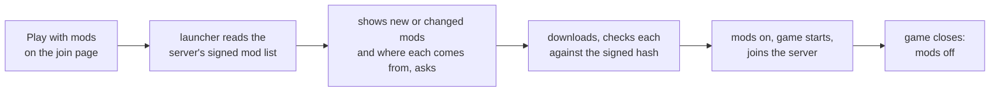

# Mods

| Kind | Runs on | Set up in |
|---|---|---|
| [Player mods](#player-mods) | players' PCs, through the launcher | `plugins.yaml` |
| [Server mods](#server-mods) | the server | `paks-local/`, `ue4ss-local/` in the data volume |

How players' launchers trust a server and its mods: [SECURITY.md](../SECURITY.md).

## Player mods

```sh
cp plugins.example.yaml plugins.yaml   # edit it with any editor
bin/moonpool mods publish plugins.yaml
bin/moonpool mods list
```

- Each entry needs a download link: a GitHub release file, a CurseForge file page or a Nexus file page.
- CurseForge needs `CURSEFORGE_API_KEY` in `.env` (free at console.curseforge.com) and an author who allows distribution; otherwise players download it from its page.
- Nexus files, and CurseForge files their author keeps on CurseForge: run `bin/moonpool mods pin "<name>" <file.zip>` once. The server never fetches or serves these; players download them and the launcher checks they match.
- `.pak` mods need `kind: pak`. Optional mods are ticked unless `default: false`.
- The join page shows each mod's `summary`, or its own description from GitHub or CurseForge, with stars or downloads, last update and author. These are read in the background at most every `MOD_STATS_MAX_AGE` seconds (21600, six hours), and again when the list's mods or their pages change. CurseForge needs the key; `GITHUB_TOKEN` in `.env` raises GitHub's limit of 60 reads an hour and is sent only to `https://api.github.com`.

## On the player's PC

Players install the launcher once, from the join page. Pressing **Play with mods** then does this:




- Mandatory mods are ticked and locked. Choices are remembered per server and asked again, with changes marked, when a mod is added or changes.
- To change them any other time: the "Subnautica 2 (*server*, choose mods)" Start menu shortcut, or **Change mods** in the launcher's window, which shows only for the few seconds it takes to get ready.
- Each row says whether the mod is installed, an update or new. The question says Install, Update or Choose to match.
- Mods are on only while the game the launcher started is running. If the launcher is killed mid-game, they stay on until its next run or the "Subnautica 2 (without Moonpool mods)" shortcut.
- The player's own mods are left alone, except a `UE4SS_Signatures` folder the server didn't send, which is moved aside while Moonpool's mods are on.
- A mod loader installed another way is replaced only after asking, with a copy in `%LOCALAPPDATA%\Moonpool-replaced`.
- Two settings go into the game's `Engine.ini` for the session and come out when the game closes; a value the player set is kept. `r.ShaderPipelineCache.BackgroundBatchSize=100` shortens the shader wait before joining (about 3 minutes to 7 seconds on one PC), and `ConfiguredInternetSpeed`/`ConfiguredLanSpeed=300000` speed up loading.
- Steam only: Xbox and Game Pass players join without mods.

Player logs: the "Subnautica 2 (collect logs for the host)" Start menu shortcut, or `moonpool.ps1 -CollectLogs`, puts one zip on the Desktop.

| In it | Left out | Still in it |
|---|---|---|
| the launcher's log, the game's and UE4SS's logs, the record of placed files, crash folder names | Windows user and PC names, crash dumps; nothing is uploaded | the server, its players and Steam IDs: send it only to the host |

Uninstall: close Subnautica 2, then in PowerShell:

```powershell
powershell -ExecutionPolicy Bypass -File "$env:LOCALAPPDATA\Moonpool\moonpool.ps1" -Uninstall
```

- Removes every game file it placed that is unchanged, folders left empty, its `moonpool:` link handler, shortcuts and own folder. Files changed since stay and are named.
- Copies in `%LOCALAPPDATA%\Moonpool-replaced` stay and aren't put back. `-Adopt` replaces files without asking or copying.
- Steam's Verify integrity of game files restores the game's own files.

## Server mods

- **Pak mods**: `.pak`, `.ucas` and `.utoc` files in `paks-local/` in the data volume. Each launch copies them into the game's `Content/Paks/~mods` and removes ones you've taken out. Mods that change game rules (storage sizes, vehicle stats) usually need to be on the server as well as in `plugins.yaml`; the host decides those in co-op.
- **UE4SS mods**: `ue4ss-local/Mods/<name>/` in the data volume, with an empty `enabled.txt` beside `Scripts`; recreate the host. To remove one, delete it there and from `ue4ss/Mods` in the game folder. Most act on the local player, so they do nothing on a server; list those in `plugins.yaml` instead.

> **A server mod is trusted like your hosting account's password.** It runs as the same user as Steam and the game, so it can read the Steam sign-in, the key that signs your mod list, your Discord webhook and the other secrets in the container. Only install server mods from people you'd hand that account to. Player mods (above) don't get this: they run on players' own PCs.

## Players' loader on experimental builds

On some builds the mod loader needs layout files its release lacks, or the game crashes about ten seconds after start.

| Files | For | Put in the data volume at |
|---|---|---|
| `MemberVariableLayout.ini`, `VTableLayout.ini`, `UE4SS-settings.ini` that work on a player's PC for the current build | players | `ue4ss-client/` |
| a fixed copy of one of the loader's own files, at its path under `Mods/` (as `Mods/shared/UEHelpers/UEHelpers.lua`) | players | `ue4ss-client/Mods/` |
| the server's own set | the server | `ue4ss-local/` ([Updates](operating.md#updates)) |

- The settings file matters: on experimental build 26496980 the release's default crashes the game. The working file sets `MajorVersion = 5`, `MinorVersion = 6`, `DebugBuild = false`.
- The pinned loader is served with those files added, under its own name and hash. Anyone who can reach the join page can fetch it.
- A player is asked before their own layout files are replaced.
- On experimental build 0.1.2.0-138154, calling a game function by name throws `Array failed invariants check`, so mods built on UE4SS's `UEHelpers` (Simple Minimap) never find the player. A fixed `UEHelpers.lua` is in [`client-mods/ue4ss-client`](../client-mods/ue4ss-client/README.md); copy its `Mods/` into `ue4ss-client/Mods/`.
