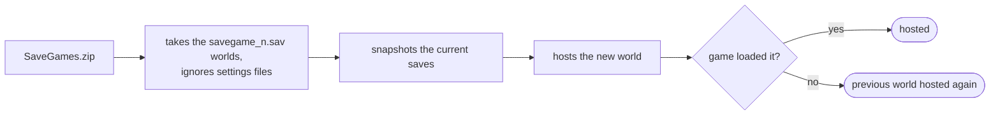

# Running Moonpool

Hosting, the network, backups, worlds, updates and troubleshooting.

| Also | |
|---|---|
| [mods.md](mods.md) | publishing mods, the launcher, server mods |
| [admin.md](admin.md) | in-game admin |
| [map.md](map.md) | the map |
| [SECURITY.md](../SECURITY.md) | trust, listeners, secrets |
| `.env.example`, `bin/moonpool help` | the usual settings (diagnostic switches are [below](#diagnostic-switches)), every command |

## Size

| Players | Cores | Memory | SSD | Upload |
|---|---|---|---|---|
| 2 | 2.3 | 6 GB | | |
| 4 | 4 | 8 GB | 40 GB | 10 Mbit |

Two players was measured on a test host; four is scaled from it. `metrics.csv` in the data volume shows what your host uses.

On Windows, Docker Desktop keeps everything in one disk file on the system drive. It grows as the game downloads and does not shrink when volumes are deleted, so the 40 GB has to be free on that drive. A drive that fills mid-download leaves Steam's update paused ([Updates](#updates)).

An empty server costs less with the friends preset:

- Two minutes after the last player leaves (`IDLE_SLOW_MINUTES`), the frame cap drops to `IDLE_MAX_FPS` (10). It comes back when someone logs in, or at the latest at the next roster check. On a test host that took an empty game from about 3.3 cores to two-thirds of one. `IDLE_MAX_FPS=0` turns it off.
- After `IDLE_FREEZE_MINUTES` (10) the in-game clock stops until the next join.
- `IDLE_STOP_HOURS` stops the game after that many hours empty, freeing CPU and memory; nobody can join until it starts again.

Joining players get world data at up to `NET_MAX_CLIENT_RATE` bytes a second each:

| Preset | Rate | Join load time on a test host |
|---|---|---|
| `friends` | 300000 | about half |
| `stock` | 100000 (the game's own) | normal |

## Signing in

- Use the hosting account with Steam Guard on, and pick Remember me.
- To paste, put the text in the noVNC side panel's clipboard, then press Ctrl+V in Steam.
- You type the password into Steam. Moonpool doesn't ask for it or keep it, and it isn't in `.env`.

The viewer controls the signed-in Steam. Keep it off the internet.

- It always has a password, made at first start unless `VNC_PASSWORD` is set. `bin/moonpool diag viewer` shows it.
- VNC uses only the first 8 characters, and its handshake isn't encrypted.
- Inside Docker it listens on every interface; the password keeps other containers out.
- From elsewhere use an SSH tunnel or Tailscale, even with `VIEWER_BIND=0.0.0.0` on your LAN.

The sign-in:

- stays in the data volume, and anything in the container can use it
- is read by Moonpool for the Steam web session, to find the lobby for the join link and to accept friend requests

Use a dedicated account and keep the volume private.

Lost the machine? Deauthorize devices in Steam and change the password. `docker compose down -v` deletes the world and its saves for good.

## Joining

The game needs no forwarded port.

1. `bin/moonpool players invite <steamid64 or profile link>`.
2. The player sends the hosting account a friend request.
3. Accept it in the viewer, or set `AUTO_ACCEPT_FRIENDS=1` and Moonpool accepts invited players within a minute (five a minute at most).
4. They press Join Game or use the join page.

- `ALLOWLIST_ONLY=false` lets in anyone who asks.
- With `AUTO_ACCEPT_FRIENDS=0` Moonpool still counts waiting requests once a minute. The Discord card and `bin/moonpool status` show how many it would let in.
- Existing friends of the account can join until removed in the viewer or with `bin/moonpool ban add`.
- Everyone needs the same `STEAM_BRANCH` and game build.

| Command | Effect |
|---|---|
| `players kick` | removes a player for now |
| `ban add <name>` | removes a matching player whenever they join |
| `ban add <steamid64>` | also unfriends them, with `AUTO_ACCEPT_FRIENDS=1`; otherwise remove them in the viewer too |

## Public address

Players reach the join page and mods on port 8081. Pick one:

- **Quick tunnel**: `TUNNEL=quick` and `COMPOSE_PROFILES=tunnel` in `.env`. Free. The address is random and changes when the tunnel restarts. The Discord card and `bin/moonpool status` show the current one.
- **Stable, no domain**: [Tailscale Funnel](https://tailscale.com/docs/features/tailscale-funnel). Run `tailscale funnel --bg http://127.0.0.1:8081` on the host, then set `SN2_PUBLIC_URL=https://<machine>.<tailnet>.ts.net`, `TUNNEL=off`, `MODS_BIND=127.0.0.1`. Free, in beta, with unstated bandwidth limits; test a mod download.
- **Your own domain** on Cloudflare (the tunnel is free; you pay for the domain):
  1. A domain bought elsewhere: add it to Cloudflare's free plan and set its name servers to the two Cloudflare gives.
  2. Dashboard, Networking, Tunnels: create a tunnel, choose Docker, copy the token from the command shown.
  3. Add a Published application route: your hostname, service `http://sn2:8081`.
  4. In `.env`: `TUNNEL=token`, `COMPOSE_PROFILES=tunnel-token`, `TUNNEL_TOKEN=<token>`, `SN2_PUBLIC_URL=https://<hostname>`. Recreate the host.

  Anyone with the token can run your tunnel. Keep it out of chat, screenshots and the repo.
- **Your own network only**: `http://<this machine's address>:8081/join`.

Never forward the viewer's port 8080. Don't put 8081 on the internet as plain http.

## Xbox and Game Pass players

Experimental. They can't be invited through Steam: they add the hosting account by its in-game friend code and join from the game's friends list.

`bin/moonpool diag friend-code`:

- opens the game's Friends screen (the code exists only while it's open), reads the code and closes it
- runs while nobody is on, or with `--force`
- makes a new code each run; the last one survives restarts and shows on the Discord card

## More than one world

Each world needs its own Steam account that owns the game.

```sh
bin/moonpool-instance add family experimental
docker compose -p sn2-family --env-file instances/family/.env up -d --build
bin/moonpool --instance family status
```

## Backups

| | Game's autosave (`SAVE_EVERY_MINUTES=0`) | Default |
|---|---|---|
| When | every 2 minutes | every `SAVE_EVERY_MINUTES` (10), and after players leave |
| Cost | each save stalls the server a second or more | the same, less often |
| Empty server | as the game decides | skips saves and archives |
| A crash loses | up to 2 minutes | up to `SAVE_EVERY_MINUTES` |

- Archives go into `./backups` every 30 minutes and are kept 7 days. For remote storage or encryption, copy `backup.env.example` to `backup.env`.
- They hold the saves and the game's Steam userdata folder, not the sign-in or the mod-signing key.
- Lose that key and players' launchers treat the server as new and ask again. Keep a private copy: `docker compose cp sn2:/home/container/mod-signing ./mod-signing`.

```sh
bin/moonpool server backup
ls backups                    # newest last
bin/moonpool server restore backups/<file>.tar.gz Slot1
```

Restore:

- keeps a safety copy of the current saves and hosts again about a minute later
- copies the backup in beside the live folder and swaps the two; if that fails, the current saves stay as they were and the game starts again
- refuses an archive of more than 10,000 files or 4 GiB
- checks the archive holds a save, not that the save is undamaged
- hasn't been tried with players on

Two worlds must not share a `BACKUP_DIR`; `bin/moonpool-instance` gives each its own.

## Bring your world

Move a co-op world onto the server so it's there when its old host is offline.

1. On the PC that hosted it, close the game and open its SaveGames folder: `%LOCALAPPDATA%\Subnautica2\Saved\SaveGames` on the public branch, `<Steam library>\steamapps\common\Subnautica2\Subnautica2\Saved\SaveGames` on experimental.
2. Zip the folder, or copy it to the server, and import it:

```sh
bin/moonpool server import SaveGames.zip          # the newest world in it
bin/moonpool server import savegame_2.sav Reef    # one world, renamed
```



- The game loads only saves from its own branch and build, so update the game on the old PC first.
- A zip is refused if its .sav and .bak files number more than 64, unpack to more than 512 MiB (256 MiB for one file), or one unpacks to more than 200 times its packed size.
- `bin/moonpool server export` zips the hosted world (`Slot1.sav` by default). Loading that on a player's PC hasn't been tried.

## Move the server to another PC

Everything that makes the server yours fits in one file. The game, Steam and Wine download again on the new PC.

```sh
# old PC: nobody on
bin/moonpool server pack                     # moonpool-loadout-<date>.tar.gz
bin/moonpool server stop

# new PC: clone and check out the release as in README "Start it", then, before starting it
cp .env.example .env
bin/moonpool server unpack moonpool-loadout-<date>.tar.gz   # puts .env in place: branch, tunnel, admins
docker compose up -d --build
# sign in to Steam in the viewer, wait until the game has downloaded (bin/moonpool status), then again
bin/moonpool server unpack moonpool-loadout-<date>.tar.gz   # settings, mod key and the world
```

The order matters: `.env` names the game branch, and a world loads only on its own branch, so it has to be in place before Steam downloads the game.

| In the file | Not in it |
|---|---|
| every world in SaveGames, from a quiet copy taken as you pack | the game, Steam and Wine |
| `.env` | the Steam sign-in: sign in once on the new PC |
| the mod-list signing key, so players' launchers still know the server | logs, backups, caches |
| `plugins.yaml`, `settings.yaml`, `admins.txt`, `console.json`, `card.yaml`, the map background | |
| mod overrides: `client-mods/`, `ue4ss-client/`, `ue4ss-local/`, `paks-local/` | |

- **The file holds your secrets** (`.env`, the signing key). Keep it like a password. It is written readable by its owner only on Linux; on Windows that folder's permissions decide who can read it.
- `.env` comes without `COMPOSE_PROJECT_NAME`, `SN2_CONTAINER_NAME` and `SN2_IMAGE`: they name the old PC's volumes, container and image, and on a PC with an older copy they would quietly start that copy instead.
- `unpack` replaces a `.env` that is still the example; any other `.env` is kept and the packed one goes beside it as `.env.loadout`; compare the two, then `docker compose up -d`. It puts settings back only on the list above, skips links, then brings the world in through `server restore`, which keeps a dated copy of the saves it replaces.
- Sign in on the new PC only after the old one has stopped: one Steam account, signed in twice, logs the first out. Never run both: they also share one tunnel. `docker update --restart=no` on the old PC's containers keeps a reboot from starting them.
- Free space: a fresh install takes about 35 GB inside Docker's disk. Old volumes count; `docker system df -v` shows them.
- Use the same release on both PCs; `git describe --tags` says which.

## Updates

- Steam can update the game whenever it runs. If the world has saves, Steam starts only after they're copied; `UPDATE_WITHOUT_BACKUP=true` skips that.
- **"Steam stopped the game download (… Corrupt update files)"** in `bin/moonpool logs services`: usually a disk that filled mid-download. Steam waits and won't retry by itself. Free space, then take a copy of the world first (on the experimental branch the saves live inside the game folder) and clear Steam's half-staged download and its record of the game, so it downloads again:

  ```sh
  bin/moonpool server pack
  docker compose stop sn2
  docker compose run --rm --no-deps --entrypoint sh sn2 -c 'cd "/home/container/wine/drive_c/Program Files (x86)/Steam/steamapps" && rm -rf downloading/1962700 appmanifest_1962700.acf'
  docker compose start sn2
  ```

  Seen and fixed on a fresh install with no world yet; there the whole game folder was removed too. On a server with a world, check after the download that `bin/moonpool server saves` still lists it, or `server unpack` the copy.
- `RESTART_CRON` restarts the game only and never updates it. When the card shows a build players can't join on, run `bin/moonpool server restart`: it warns players, counts down and recreates the container (`--now` skips the countdown).
- `AUTO_UPDATE=false` only stops Moonpool asking Steam to validate the game. Steam can still update it.

A new build hosts only if the mod loader works on it:

| Branch | What you do |
|---|---|
| public | nothing |
| experimental | not supported out of the box. It may need a `MemberVariableLayout.ini` and `VTableLayout.ini` that fit the build, which you supply in `ue4ss-local` in the data volume. Without them the game crashes before hosting and the card says Not hosting |

- `ue4ss-local` is copied over the loader's files on every launch and survives game updates.
- Players may need their own set too ([mods](mods.md#players-loader-on-experimental-builds)).
- The older pinned loader takes a set per build in a folder under `ue4ss-layouts`: `MemberVariableLayout.ini`, `VTableLayout.ini`, `UE4SS-settings.ini`, `UE4SS_Signatures`, and the game exe's SHA-256 in `exe.sha256`.

## Hooks and scheduled jobs

Two files in the data volume, both able to call anything in `bin/moonpool`:

- `hooks/on-event`, if executable, runs on `join`, `leave`, `up`, `restart`, `update` and `outage` with the event and its detail as arguments. Output: `logs/hooks.log`. It runs with the host's rights.
- `crontab` adds your own schedule. Recreate the host after changing it. Output: `logs/cron.log`.

`world time` and `world weather` need `settings` in `enabled_commands` ([console commands](admin.md#console-commands)).

```
0 20 * * 5 moonpool notify "Storm coming" && moonpool world weather StormA
```

```sh
#!/bin/sh
[ "$1" = join ] && moonpool notify "$2 is aboard"
```

| Log | Kept |
|---|---|
| most of `logs/` | 10 MB plus four older pieces |
| `game.log` | this launch; the last one as `game.log.prev` |
| `join_watch.log` | never cut: the player count is read from it |

## Discord card

1. Make a channel. Let `@everyone` read and add reactions but not send messages.
2. Channel settings, Integrations › Webhooks › New Webhook; copy its URL. Anyone with it can post there.
3. Set `DISCORD_WEBHOOK_URL=` in `.env` and run `docker compose up -d`. The card appears within a minute and is edited in place.

For mentions on important alerts, set `DISCORD_ALERT_ROLE_ID` to an opt-in role's id.

## Make it yours

Change what players see from the data volume.

```sh
docker compose cp sn2:/opt/sn2/web/theme.css theme.css
docker compose cp theme.css sn2:/home/container/templates/theme.css
docker compose cp sn2:/opt/sn2/web/join.html.j2 join.html.j2
docker compose cp join.html.j2 sn2:/home/container/templates/join.html.j2
```

- `templates/theme.css`: every colour, font, size and edge of the join page, map page and map still. Pages pick it up on refresh.
- `templates/join.html.j2`: the join page. A copy that fails to render is logged and the shipped page used. It gets `world`, `join`, `friend`, `refresh`, `banner`, `modnote` (the launcher button and the mod list), `mod_action` and `mod_list` (the same, split), `mods_published`, `build`, `branch`, `branch_label`, `map` (the map still, or empty when the map is off; the page then embeds `map.html?embed=1`), `map_facts` (such as `15 min behind`, `2 players`), `game` (`GAME_NAME`, or Subnautica 2) and `theme` (a fingerprint; link `theme.css?{{ theme }}`).
- `templates/banner.png` (or `.jpg`, `.jpeg`, `.webp`, `.gif`): a picture at the top of the join page, served as is.
- `templates/map.html`, from `web/map.html`: a whole page you own, scripts included.
- `card.yaml`, from [card.example.yaml](../card.example.yaml): the Discord card's wording. Layout and buttons stay. A bad line is logged and the shipped one kept.

## When something's wrong

| Problem | Do |
|---|---|
| Not sure the host is right | `bin/moonpool diag verify-fresh` checks each stage from Steam to the hosted save |
| No session | `bin/moonpool status`, then `bin/moonpool logs game` |
| Container up, game not running, `bin/moonpool status` says `stopped by moonpool server stop` | the stop holds across `docker compose up -d` and restarts; `bin/moonpool server start` lifts it |
| No session, and `logs join_watch` says `host mod never started` | the UE4SS loader failed as the game started (its `UE4SS.log` ends in `Fatal Error`). The server stops the game once, 10 minutes after launch, so it starts again; if the next start fails too it leaves it and says so. Seen once on build 26496980, then fine on the next start |
| Join Game is missing | check in the viewer that Steam is signed in and on the right branch |
| A player connects and drops | compare branch and build, then `bin/moonpool logs join_watch` |
| The game won't install | `bin/moonpool diag screenshot shot.png` |
| `clock jumped -1 secs` repeating in `bin/moonpool logs web` | the PC's clock is off. On the PC: `Start-Service w32time; w32tm /resync /force` |
| Choppy while admins run many console commands | each can stall the server; run big batches when nobody's on |

`bin/moonpool diag bundle` makes one zip for whoever helps you:

| In it | Taken out | Never read |
|---|---|---|
| game, UE4SS and service logs; status files; the last hour of `tick-report`; the Wine and sync in use; a summary | the values of `DISCORD_WEBHOOK_URL`, `CURSEFORGE_API_KEY`, `GITHUB_TOKEN`, `VNC_PASSWORD`, `STEAM_BRANCH_PASSWORD`, `TUNNEL_TOKEN` and any Discord webhook address | the Steam session, `.env`, the viewer password, the mod-signing key, saves |

Player names and Steam IDs stay: share it only with someone you trust.

Choppy play:

```sh
docker compose exec sn2 python3 /opt/sn2/bin/tick-report.py --from 2026-11-12T20:00 --window 10
```

Per window (UTC) it shows:

- slow frames: median, p95, p99, and how many were over 0.5 s and 1 s
- moves dropped as too old
- game autosaves, host saves and console commands
- player count (compare windows with the same count)

Known gaps:

- the current build refuses `Warp`, so players can't be moved
- the join hold during the launch cinematic is unproven

## Diagnostic switches

Not in `.env.example`; the defaults work. Set one in `.env` only to rule something out, then recreate the host.

| Setting | Default | What it does |
|---|---|---|
| `GAME_APP_ID` | `1962700` | Steam app id of Subnautica 2 |
| `NULLRHI_ARGS` | `-nullrhi -unattended -log` | Engine arguments; `-nullrhi` is added back if missing (no GPU) |
| `WINE_SYNC` | `auto` | The default image runs wine-tkg-staging-fsync 10.10: `auto` and `fsync` use fsync, `esync` uses esync, `off` uses neither. An image built with `--build-arg WINE_RUNTIME=winehq` has neither, so only `auto` and `off` apply there. The game's launch log says which is in use |
| `UE4SS_AT_START` | `true` | UE4SS loads at process start through its `dwmapi.dll` proxy |
| `UE4SS_TAG` | `experimental` | The upstream release tag the pinned loader is fetched from |
| `NATIVE_MSVC` | `1` | Microsoft's C++ runtime for the game process only |
| `HOST_PRUNE` | `true` | Takes the host account out of the player list |
| `HIDE_HOST_BODY` | `true` | Hides the host account's body in the world |
| `CHEAT_GATE` | `on` | `off` lets the server host without the cheat gate, so any player's console cheats run. Only to rule the gate out |
| `CLIPBOARD_BRIDGE` | `true` | Copy and paste through the viewer's clipboard panel |
| `S6_SERVICES_GRACETIME` | `210000` | Milliseconds the services get to stop: warning plus save wait plus 30 s |
| `S6_KILL_GRACETIME` | `5000` | Milliseconds before leftover processes are killed |
